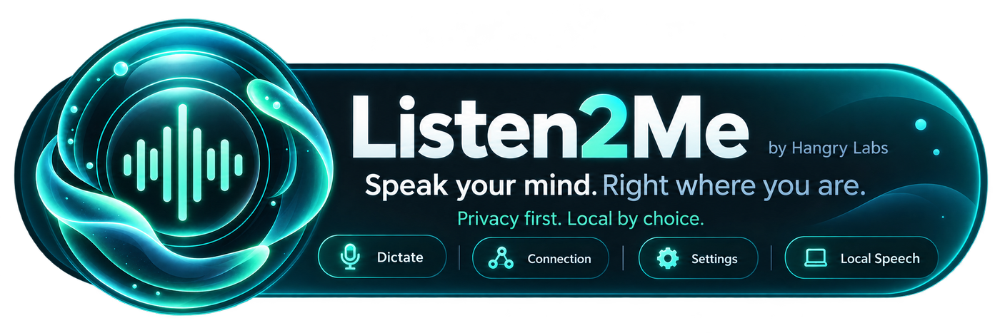
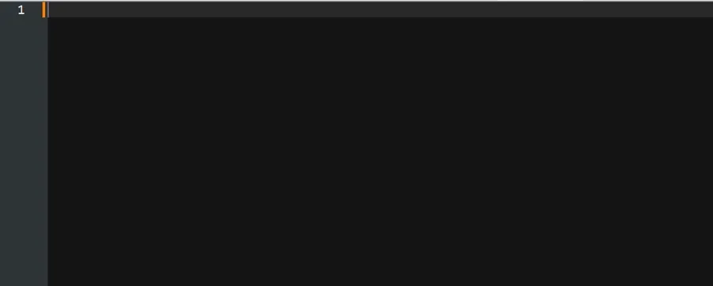
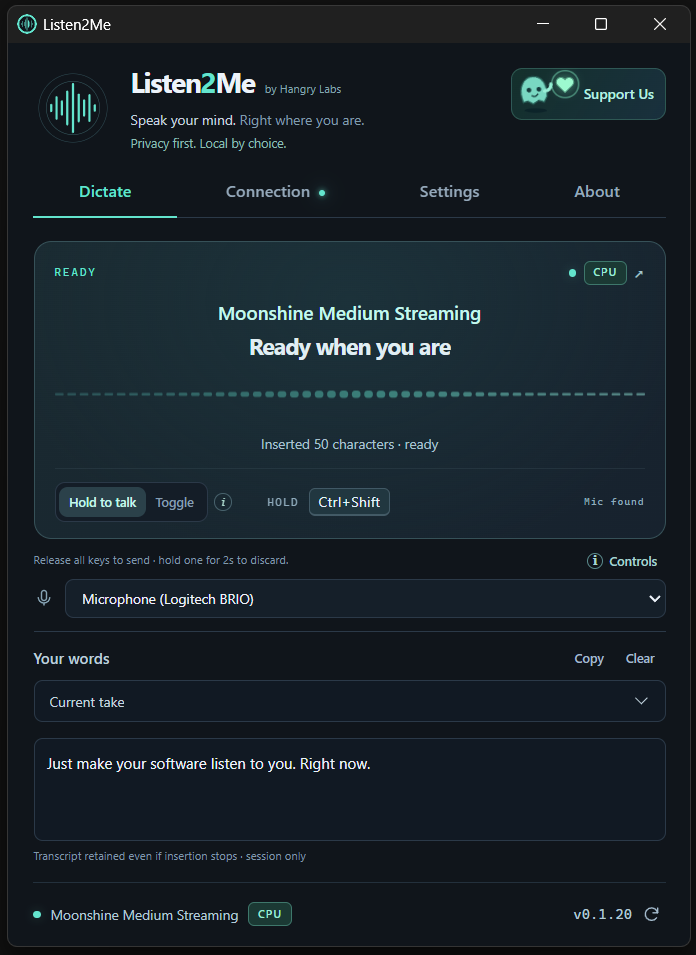
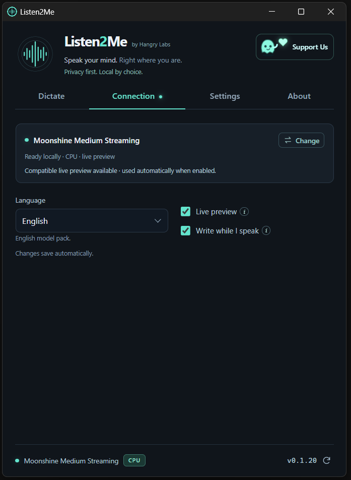

# Listen2Me

**Speak your mind. Right where you are.**

Listen2Me is a free Windows desktop dictation app from Hangry Labs. Hold your
shortcut or go hands-free, speak into your microphone, and have the recognised
text typed into the text field you selected.

This repository contains public documentation, artwork and downloadable release
assets. The application is proprietary; its source is maintained separately.

**Now in beta: 0.7.11.** Free to use, with local speech recognition or your own
hosted endpoint.

## See it in action

| Dictate | Connection |
| --- | --- |
|  |  |

Screenshots were captured during development; small details may change between builds.

## Downloads

Download **`Listen2Me-Setup.exe`** from the [Releases page](https://github.com/hangry-labs/Listen2Me/releases).
Configure hosted recognition or explicitly download your preferred local model.
The installer runs per user and preserves existing settings and downloaded models.
It is also the normal in-app update package.

Current beta releases provide the standard installer only; an offline bundle is
not currently published. Once downloaded, local models work without an inference
server or internet connection. Optional models and CUDA runtimes require their
initial download.

No Git checkout or development tools are required. Preview releases may change frequently.

Current installers are **self-signed**, rather than signed by a publicly
trusted publisher. Windows may display a trust warning. Each release includes
SHA-256 checksums and a public publisher certificate for verification; installing
that certificate as a Windows trusted root is not required or recommended.
Download only from the official release page.

Listen2Me is early-access software. Releases on the stable update channel are
available to the in-app updater; that channel name does not imply a mature 1.0
release. Review the release notes before installing.

Requires Windows 10 version 1809 or newer / Windows 11, x64, a microphone and
Microsoft WebView2 Runtime. The installer runs per user without administrator
rights. Windows on ARM and non-Windows operating systems have not been qualified.

If WebView2 is missing, setup offers to download Microsoft's runtime (about
206 MiB) and install it after you accept Microsoft's licence. Existing runtimes
are left alone. A cancelled or failed prerequisite download stops setup before
Listen2Me files are changed. Downloaded speech models are a separate choice.

## Choose your speech recognition

The optional installation wizard can configure a hosted ASR endpoint or explicitly
download a local model. You can also set this up later inside the app.

- **Parakeet TDT v3 Q8:** recommended multilingual completed-take dictation, CPU
  or a compatible NVIDIA CUDA GPU.
- **Moonshine Medium Streaming:** recommended English live preview on CPU.
- **Moonshine Small Streaming:** lighter English live-preview alternative on CPU.
- **Nemotron 3.5 Q8:** multilingual live preview, CPU or compatible NVIDIA CUDA.
- Whisper Base, Small and Large v3 Turbo Q5 are also available. Turbo can be slow
  on CPU. Recognition and punctuation vary with speech, language and hardware.

With the standard installer, model/runtime downloads are optional and substantially larger than the installer.
The Model Wizard shows download sizes, progress and supported acceleration before
use. Model cards distinguish downloaded, partially downloaded and missing files,
with separate CPU/GPU runtime status. Interrupted downloads retry automatically
with a bounded backoff and retain partial progress for a later retry, including
after restarting the app. Servers that do not support resuming restart that file.
Every completed download is checked against its pinned SHA-256 before use. Local GPU runtimes are downloaded separately when selected. Model licences
and attribution remain in their downloaded folders.

Hosted recognition supports compatible OpenAI-style transcription APIs and Qwen
ASR streaming APIs. Enter your endpoint and use Check to discover capabilities.
Discovery does not send a recording. Hosted providers may apply charges or retain
audio under their own terms.

## Controls

The default shortcut is **Ctrl + Shift**; change it in Settings.

- **Hold:** speak while holding the shortcut, then release all its keys to finish.
- **Hands-free:** while keeping one modifier held, release and re-press the other
  within one second during the first five seconds. Either key works. Release
  the keys and keep talking; press the shortcut again to finish.
- **Discard:** release one modifier but keep the other held for two seconds.
- **Toggle:** select Toggle mode; one shortcut starts and the next finishes.
- **Write while I speak:** optional with streaming. Use Toggle/hands-free or a
  single non-modifier key such as F9 for live typing. Modifier holds buffer typing
  until the modifiers are released. Late revisions can stop insertion; the final
  transcript remains in Your words for recovery.

Select your destination text field first and keep it selected. Listen2Me does not
restore an earlier window. Enter is sent only if you enable a custom phrase for it.
It cannot reliably distinguish
all internal text fields in every editor. Review the result before sending it.
Cancelling stops further work; it does not remove text already typed or recall
audio already received by a hosted server.

## Custom phrases

In **Phrases**, map words you say to replacement text or an optional **Shift+Enter**
or **Enter** action. For example, “my page” can write your website address.
Rules are saved on your computer and can be edited, disabled or removed.

Use distinctive commands such as **“hashtag new line”** for Shift+Enter and
**“hashtag enter”** for Enter, with any wording in your language. These examples
are not enabled automatically. If your model writes “hashtag” as `#`, add that
spelling separately. Matching ignores case and uses whole words.

Shift+Enter usually adds a line break; Enter can send a message or submit a form.
The receiving app decides. With live writing, actions may happen before you finish
speaking and cancellation cannot undo them. Unfinished phrases stay buffered;
late revisions stop further insertion instead of replaying an action.

## Privacy and updates

Local recognition processes audio on your computer. Hosted recognition sends it
directly to your chosen server. There is no built-in publisher analytics,
advertising or automatic upload of recordings/transcripts to Hangry Labs.
Session history is kept in process memory. Windows paging/crash dumps and the
receiving application's own saving behavior are separate.

Settings/models normally live in `%LOCALAPPDATA%/Listen2Me` and survive upgrades
and uninstall. Local models load and stay ready by default without opening the
microphone. Settings can instead load on demand and unload after a chosen idle
period, or after each take. Pause in the tray releases the worker. The voice card
groups model, processing location, waveform, Hold/Toggle and the shortcut. Its
release/discard help sits below it; About has a separate tab.

The footer shows your selected ASR and local loading/residency state. Hosted
server memory is controlled by the provider and cannot be inferred from a
successful connection. Click the version to open releases, or its circular
refresh icon to check for updates. The footer offers an explicit check, verified download and Install action.
Install starts the verified installer and restarts Listen2Me without switching
tabs. Pending valid changes are saved first; correct invalid changes before
installing.
Listen2Me checks for a newer version on opening by default; turn this off in
Settings for manual-only checks. It never downloads or installs app updates
automatically. Routine updates use
the small standard installer, retaining previously installed models, including
Parakeet from the offline edition. Microsoft's WebView2 Runtime has its own
automatic-update and SmartScreen behavior when online. The installer preserves settings and
models; Fresh settings makes recoverable configuration/cache backups. Versions
older than 0.1.9 need one manual tray Quit before their first update.

The Support Us button has an optional feedback form; no email or account is required.
Reports are retained in the website feedback inbox without email forwarding. Only submitted text,
type, optional email and app version/platform are sent; the website also sees
ordinary connection metadata. Failed submissions remain in the form and are not
retried automatically.

Read the [privacy notice](PRIVACY.txt), [software licence](LICENSE.txt) and
[third-party notices](THIRD_PARTY_NOTICES.txt). The app also includes About,
contacts, its licence and privacy notice offline. Listen2Me is provided
free of charge and as is. Recognition can be wrong.

## Contact

- General questions and privacy requests: [contact@hangrylabs.app](mailto:contact@hangrylabs.app)
- Product help: [support@hangrylabs.app](mailto:support@hangrylabs.app)
- Private vulnerability reports: [security@hangrylabs.app](mailto:security@hangrylabs.app)
- Ordinary bugs/features: [GitHub issues](https://github.com/hangry-labs/Listen2Me/issues)
- Project website: [Hangry Labs](https://hangrylabs.app/)

Hangry Labs is the project/publisher brand. No support response time or service
level is promised. Please do not post credentials, private recordings or sensitive
dictation in public issues.

Connection changes save automatically after a short pause, with an amber pending
indicator and a brief Saved confirmation. Language menus use native language
names and the selected model's advertised capabilities. Some models only support
English; unknown hosted APIs still allow an explicit language code.

The recording limit defaults to one hour. Local completed takes are processed in
shorter consecutive pieces; accuracy around boundaries and processing time depend
on the model. Hosted providers have their own duration, upload-size and timeout
limits; longer capture does not override them. One hour of mono audio uses about
110 MiB for raw samples alone, with additional processing memory. Cancel still
discards a take; reaching the configured limit finishes it. The selected
microphone is enumerated without opening it until you use your shortcut.
Listen2Me's own feedback field can also receive dictation.

Settings also saves automatically after a short pause. A pending-only dot and floating
Saved confirmation show progress; failed or invalid edits stay in the form.
Timing options share a row and their info buttons explain limits. Hold/Toggle
help is beside the recording-mode switch on Dictate.

Use Settings → Restore defaults to reset shortcut, timing, checkbox and model
readiness options. Your selected model, endpoint, microphone and downloaded files
are kept. Out-of-range numeric values are highlighted with their allowed ranges
and stay unsaved until corrected. The startup preference enables the shortcut
when the app opens; it never starts recording. With Keep ready, an enabled local
model may preload without opening the microphone.

The About tab contains contacts and legal documents. Support Us opens the
compact project card; Send feedback opens the optional form and retains drafts
when closed or when delivery fails. Privacy first. Local by choice: hosted
recognition still sends audio to the endpoint you select.

Startup checks request only the official GitHub release metadata; GitHub sees
ordinary connection information such as your IP address. There is no automatic
installer download, installation or background retry loop. You choose whether
and when to update. Hangry Labs does not receive publisher analytics, usage
profiles or automatic uploads of recordings/transcripts. Optional feedback and
third-party download/hosted-ASR connections are described in the privacy notice
and the Support Us page.

Use Connection → Change to choose Local or Endpoint. For local recognition, choose
CPU or an available NVIDIA GPU, then optionally filter by language. Auto shows
all models; English-only packs remain English-only. Compatible model cards are
listed in recommended order. The hardware summary explains what was detected,
and GPU is disabled when no compatible NVIDIA GPU/driver is available. GPU use
requires its verified runtime. Filtering never starts a download; choose
Download / verify explicitly, then Use selected model when it is ready.

Endpoint setup accepts an optional API key. New keys are encrypted for the
current Windows user and tied to that server; only a file reference is saved in
settings. Leave the field blank to keep a same-server key. Switching servers
requires a new key if authentication is needed; Use no API key disables it.
Existing token-file configuration remains supported.

Click the model language field and type a native or English language name/code
to narrow the choices. Enter selects a match; Escape keeps the previous choice.
A compatible detected NVIDIA GPU is preselected in the chooser, while CPU remains
available. Opening it does not change your running configuration until you apply.
